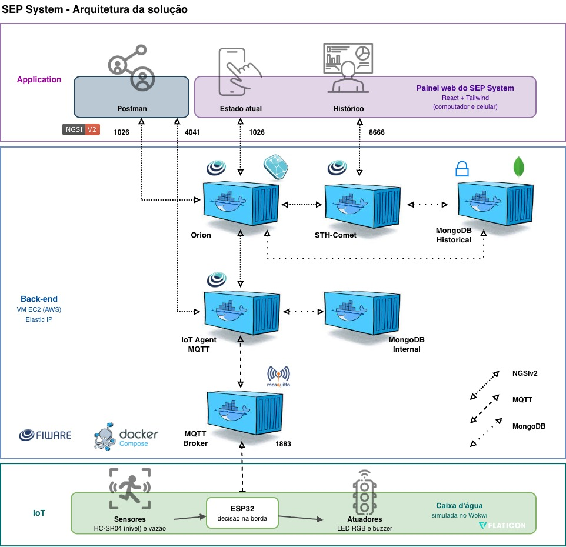

# SEP System

Monitoramento inteligente de caixas d'água para casas e condomínios. Detecta vazamentos, consumo excessivo e falta de água, alerta no local mesmo sem internet e envia os dados para a plataforma FIWARE.

Projeto da Global Solution 2026.2 (CitizenTech) da FIAP, disciplina de Edge Computing & Computer Systems.

| Recurso | Link |
|---|---|
| Simulação no Wokwi | https://wokwi.com/projects/480586487979827201 |
| Painel web (dados do firmware) | https://sepsystem.vercel.app |
| Vídeo de apresentação | `LINK_DO_YOUTUBE` |
| Back-end FIWARE | [FIWARE Descomplicado](https://github.com/fabiocabrini/fiware) na AWS |

---

## Sumário

1. [Ficha da CitizenTech](#ficha-da-citizentech)
2. [O problema](#o-problema)
3. [A solução](#a-solução)
4. [Como funciona](#como-funciona)
5. [Hardware e circuito](#hardware-e-circuito)
6. [Estrutura do repositório](#estrutura-do-repositório)
7. [Instalação](#instalação)
8. [Como utilizar](#como-utilizar)
9. [Configuração](#configuração)
10. [Solução de problemas](#solução-de-problemas)
11. [Equipe](#equipe)
12. [Créditos](#créditos)

---

## Ficha da CitizenTech

| Campo | Resposta |
|---|---|
| Nome da CitizenTech | SEP System |
| Cidade e bairro | São Paulo, Bela Vista |
| Cidadão beneficiado | Moradores de casas e condomínios e o síndico responsável pela conta de água |
| Problema, em uma frase | Vazamentos e falta de água só são percebidos quando a conta chega ou a torneira seca. |
| Como funciona | Sensores na caixa medem nível e vazão; o ESP32 classifica a situação, alerta no local e envia os dados ao FIWARE. |
| O que cada parte faz | ESP32 mede e alerta; FIWARE armazena estado e histórico; o painel web mostra os dados ao usuário. |
| Indicador de impacto | Litros economizados por mês e tempo até um vazamento ser detectado |
| ODS conectados | 6 (Água potável e saneamento), 11 (Cidades e comunidades sustentáveis), 13 (Ação contra a mudança global do clima) |

---

## O problema

A caixa d'água fica no telhado ou num lugar de difícil acesso, e quase ninguém olha para ela. Por isso:

- **Vazamentos passam despercebidos por semanas.** Uma descarga com defeito ou um cano trincado desperdiça água o dia inteiro, e o morador só descobre quando a conta chega.
- **A falta de água pega todos de surpresa.** Ninguém sabe que a caixa está acabando até a torneira secar.
- **Em condomínios, o problema se multiplica.** O síndico paga uma conta alta sem saber de onde vem o consumo.

## A solução

O SEP System é um dispositivo instalado na caixa d'água que:

1. **Mede** o nível da caixa e a vazão de saída de água.
2. **Decide** na hora se a situação é normal, de consumo alto, de possível vazamento, de caixa vazia ou de falha do sensor.
3. **Alerta no local** com luz e som, mesmo sem internet.
4. **Envia** as leituras para a plataforma FIWARE, onde ficam o estado atual e o histórico para consulta pelo painel web.

O principal diferencial é a detecção de vazamento: **de madrugada quase ninguém usa água**, então qualquer saída contínua nesse horário indica vazamento.

---

## Como funciona

### Arquitetura

A solução segue a arquitetura em três camadas da disciplina: dispositivo, back-end e aplicação.



Arquivo editável do diagrama: [arquitetura.drawio](images/arquitetura.drawio)

| Camada | Componente | Função |
|---|---|---|
| Dispositivo | ESP32 | Lê os sensores, decide o estado e aciona os alertas locais |
| Back-end | Eclipse Mosquitto | Broker MQTT que recebe as mensagens do ESP32 |
| Back-end | IoT Agent UltraLight | Traduz as mensagens MQTT para entidades NGSI |
| Back-end | Orion Context Broker | Guarda o estado atual da caixa d'água |
| Back-end | STH-Comet | Guarda o histórico das leituras |
| Back-end | MongoDB | Banco de dados do Orion, do IoT Agent e do STH-Comet |
| Aplicação | Painel web | Consulta o Orion e o STH-Comet e mostra os dados ao usuário |

### Ciclo de funcionamento

O firmware roda um ciclo contínuo, sem `delay()`, controlado por `millis()`:

| Etapa | Frequência | O que acontece |
|---|---|---|
| Medir | a cada 500 ms | Lê o HC-SR04, o sensor de vazão e o relógio |
| Tratar | a cada 500 ms | Descarta leituras inválidas e aplica média móvel |
| Decidir | a cada 500 ms | Classifica a situação em um dos 5 estados |
| Alertar | contínuo | Atualiza o LED RGB e o buzzer conforme o estado |
| Enviar | a cada 5 s e a cada mudança de estado | Publica as leituras via MQTT |

### Estados

| Estado | Condição | LED | Buzzer |
|---|---|---|---|
| `NORMAL` | Nível acima de 10% e vazão até 12 L/min | Verde fixo | Desligado |
| `CONSUMO_ALTO` | Vazão acima de 12 L/min | Amarelo fixo | Bipe curto a cada 4 s |
| `POSSIVEL_VAZAMENTO` | Vazão acima de 0,5 L/min de forma contínua entre 0h e 5h | Vermelho piscando | Intermitente |
| `CAIXA_VAZIA` | Nível abaixo de 10% | Vermelho fixo | Contínuo (tom grave) |
| `FALHA_SENSOR` | 3 leituras inválidas seguidas do sensor de nível | Azul piscando | Bipe duplo a cada 5 s |

Quando mais de uma condição é verdadeira, vale a primeira desta ordem de prioridade: `FALHA_SENSOR`, `CAIXA_VAZIA`, `POSSIVEL_VAZAMENTO`, `CONSUMO_ALTO`, `NORMAL`.

### Justificativa dos limites

| Limite | Valor | Justificativa |
|---|---|---|
| Caixa vazia | abaixo de 10% | Com menos de 10%, a caixa só tem água para poucos minutos de uso |
| Saída do estado de caixa vazia | acima de 15% | Histerese: evita que o alarme fique ligando e desligando com a água oscilando perto do limite |
| Consumo alto | acima de 12 L/min | Um chuveiro gasta de 6 a 12 L/min; acima disso há vários pontos abertos ou um cano rompido |
| Vazão de vazamento | acima de 0,5 L/min | Equivale a uma torneira pingando forte |
| Horário da madrugada | 0h às 4h59 | Período em que o consumo normal é praticamente zero |
| Confirmação de vazamento | 30 min na instalação real (5 s na simulação) | Evita alarme falso por uma descarga isolada de madrugada |
| Falha do sensor | 3 leituras inválidas seguidas | Uma leitura ruim isolada é comum; três seguidas indicam problema real |

### Tratamento das leituras

- **Leitura inválida:** o HC-SR04 não mede abaixo de 2 cm, e nenhuma distância acima de 150 cm é possível dentro da caixa. Leituras fora dessa faixa, ou sem eco em 30 ms, são descartadas. O último nível válido é mantido.
- **Suavização:** nível e vazão passam por uma média móvel das últimas 5 leituras, o que elimina oscilações da água e ruído do sensor.
- **Conversão de nível:** o sensor fica na tampa, apontado para baixo. Com a caixa cheia a água está a 20 cm do sensor; vazia, a 120 cm. O nível é calculado por:

```
nível (%) = (120 - distância) / (120 - 20) x 100
```

### Funcionamento sem internet

A decisão acontece no próprio ESP32 (computação de borda). A conexão Wi-Fi e MQTT é feita em segundo plano, com nova tentativa a cada 10 s e timeout curto, então a falta de rede nunca trava a medição nem os alertas. Sem internet, o dispositivo continua alertando no local e apenas deixa de enviar os dados.

### Contrato de dados

O ESP32 publica no formato UltraLight 2.0 do IoT Agent:

```
Tópico:   /TEF/caixa_g01/attrs
Mensagem: n|62.5|v|1.8|h|3|s|POSSIVEL_VAZAMENTO
```

| Campo MQTT | Atributo no Orion | Tipo | Significado |
|---|---|---|---|
| `n` | `nivel` | Number | Nível da caixa (%) |
| `v` | `vazao` | Number | Vazão de saída (L/min) |
| `h` | `hora` | Integer | Hora (0 a 23) |
| `s` | `estado` | Text | Estado atual |

No Orion, os dados ficam na entidade `urn:ngsi-ld:CaixaDagua:001`, do tipo `CaixaDagua`, no serviço `smart` com service path `/`.

---

## Hardware e circuito

### Componentes

| Componente | Quantidade | Função |
|---|---|---|
| ESP32 DevKit V1 | 1 | Microcontrolador com Wi-Fi |
| Sensor ultrassônico HC-SR04 | 1 | Mede a distância até a água (nível) |
| Potenciômetro | 1 | Simula o sensor de vazão YF-S201 (ver Simulação e componentes reais) |
| Potenciômetro | 1 | Simula o relógio (ver Simulação e componentes reais) |
| LED RGB (cátodo comum) | 1 | Indicação visual do estado |
| Resistor 220 Ω | 3 | Limitação de corrente do LED RGB |
| Buzzer | 1 | Indicação sonora do estado |

### Simulação e componentes reais

O Wokwi não tem todos os componentes de uma instalação real. Por isso, dois deles foram substituídos por potenciômetros na simulação. A lógica de decisão do firmware é a mesma nos dois casos: só muda a função que faz a leitura.

| Na simulação | Na instalação real | Por que a troca |
|---|---|---|
| Potenciômetro de vazão (0 a 30 L/min) | Sensor de vazão YF-S201 no cano de saída da caixa | O YF-S201 não existe na biblioteca de componentes do Wokwi |
| Potenciômetro de hora (0h a 23h) | Hora real obtida pela internet (NTP) ou por um módulo RTC (DS3231) | Permite demonstrar o horário da madrugada sem esperar até 0h |
| Confirmação de vazamento em 5 s | Confirmação de vazamento em 30 min | Permite demonstrar o estado de vazamento em poucos segundos |

Na instalação real, só mudam duas funções do firmware:

- **`lerVazaoLpm()`:** o YF-S201 gera pulsos proporcionais à vazão. O ESP32 conta esses pulsos com uma interrupção e converte em litros por minuto (para o YF-S201, a vazão em L/min é a frequência dos pulsos em Hz dividida por 7,5).
- **`lerHora()`:** passa a ler a hora do relógio sincronizado por NTP, que o ESP32 obtém pelo próprio Wi-Fi, ou do módulo RTC, que mantém a hora mesmo sem internet.

O HC-SR04, o LED RGB e o buzzer existem no Wokwi e são os mesmos da instalação real.

### Ligações

| Componente | Pino do componente | Pino do ESP32 |
|---|---|---|
| HC-SR04 | VCC | VIN (5 V) |
| HC-SR04 | TRIG | D5 |
| HC-SR04 | ECHO | D18 |
| HC-SR04 | GND | GND |
| Potenciômetro de vazão | SIG | D34 |
| Potenciômetro de hora | SIG | D35 |
| Potenciômetros | VCC / GND | 3V3 / GND |
| LED RGB | R (com 220 Ω) | D23 |
| LED RGB | G (com 220 Ω) | D22 |
| LED RGB | B (com 220 Ω) | D21 |
| LED RGB | COM | GND |
| Buzzer | positivo / negativo | D19 / GND |

### Instalação física (mundo real)

O dispositivo é dividido em duas partes:

| Parte | Onde fica | Componentes |
|---|---|---|
| Unidade de medição | Na caixa d'água: o ultrassônico na tampa, apontado para baixo, e o sensor de vazão no cano de saída. A eletrônica fica numa caixa vedada do lado de fora | HC-SR04, sensor de vazão, ESP32 |
| Painel de alerta | Onde há pessoas: portaria, sala do zelador ou cozinha | LED RGB, buzzer |

Na simulação, as duas partes estão no mesmo ESP32. Na instalação real, o painel pode ser ligado por cabo ou por um segundo ESP32 via ESP-NOW.

No circuito físico, o pino ECHO do HC-SR04 trabalha em 5 V e o ESP32 em 3,3 V. É necessário um divisor de tensão nesse pino.

---

## Estrutura do repositório

```
.
├── sketch.ino          Firmware do ESP32
├── libraries.txt       Bibliotecas usadas pelo Wokwi
├── README.md           Este arquivo
├── SEP_System_FIWARE.postman_collection.json
└── images/             Arquitetura da solução (imagem e arquivo editável)
```

---

## Instalação

A instalação tem três partes, nesta ordem: back-end FIWARE, provisionamento e firmware.

### Pré-requisitos

- Conta na AWS com crédito ou nível gratuito disponível
- [Postman](https://www.postman.com/downloads/) instalado
- Conta no [Wokwi](https://wokwi.com) (para salvar a simulação)

### Parte 1: back-end FIWARE na AWS

O back-end usa o [FIWARE Descomplicado](https://github.com/fabiocabrini/fiware) do Prof. Fábio Cabrini, sem alterações, rodando numa máquina virtual EC2.

#### 1.1 Criar a máquina virtual

No console da AWS, abra **EC2 > Instances > Launch instance** e preencha:

| Campo | Valor |
|---|---|
| Name | `sep-system-fiware` |
| AMI | Ubuntu Server 24.04 LTS (64-bit x86) |
| Instance type | `t2.micro` ou `t3.micro` (1 vCPU e 1 GB de RAM, o mínimo do FIWARE Descomplicado) |
| Key pair | Crie um novo par de chaves (`.pem`) e guarde o arquivo |
| Storage | 20 GB gp3 |

#### 1.2 Liberar as portas

Em **Network settings > Edit**, crie um Security Group com estas regras de entrada (**Inbound rules**):

| Porta | Protocolo | Origem | Serviço |
|---|---|---|---|
| 22 | TCP | My IP | SSH |
| 1026 | TCP | 0.0.0.0/0 | Orion Context Broker |
| 1883 | TCP | 0.0.0.0/0 | Eclipse Mosquitto (MQTT) |
| 4041 | TCP | 0.0.0.0/0 | IoT Agent MQTT |
| 8666 | TCP | 0.0.0.0/0 | STH-Comet |

Não libere a porta 27017 (MongoDB): o banco não deve ficar acessível pela internet.

Clique em **Launch instance**.

#### 1.3 Fixar o endereço IP

O IP público de uma instância EC2 muda toda vez que ela é parada e ligada de novo. Para que o firmware e o Postman sempre encontrem a VM, associe um Elastic IP:

1. Abra **EC2 > Elastic IPs > Allocate Elastic IP address** e clique em **Allocate**.
2. Selecione o IP criado, clique em **Actions > Associate Elastic IP address** e escolha a instância `sep-system-fiware`.

Anote esse IP. Ele será usado no Postman e no firmware.

#### 1.4 Conectar na VM

Pelo terminal, na pasta onde está a chave:

```bash
chmod 400 sua-chave.pem
ssh -i sua-chave.pem ubuntu@ELASTIC_IP
```

Também é possível usar o botão **Connect > EC2 Instance Connect** no console da AWS.

#### 1.5 Instalar o Docker e subir o FIWARE

```bash
sudo apt update
sudo apt install -y docker.io docker-compose-v2 git
git clone https://github.com/fabiocabrini/fiware
cd fiware
sudo docker compose up -d
```

Na primeira execução, o Docker baixa as imagens, o que leva alguns minutos.

#### 1.6 Conferir os serviços

```bash
sudo docker compose ps
```

Os seis containers devem aparecer como `Up`:

| Container | Serviço |
|---|---|
| `fiware-orion` | Orion Context Broker |
| `fiware-iot-agent` | IoT Agent MQTT |
| `fiware-sth-comet` | STH-Comet |
| `fiware-mosquitto` | Eclipse Mosquitto |
| `fiware-mongo-internal` | MongoDB do Orion e do IoT Agent |
| `fiware-mongo-historical` | MongoDB do STH-Comet |

Teste cada serviço pela própria VM. Os três comandos devem responder com JSON:

```bash
curl -s localhost:1026/version
curl -s localhost:4041/iot/about
curl -s localhost:8666/version
```

#### 1.7 Ligar, desligar e reiniciar

| Ação | Comando (dentro da pasta `fiware`) |
|---|---|
| Parar os serviços (os dados são mantidos) | `sudo docker compose down` |
| Subir os serviços | `sudo docker compose up -d` |
| Apagar todos os dados e começar do zero | `sudo docker compose down` seguido de `sudo docker volume rm fiware_mongo-historical-data fiware_mongo-internal-data` |

Os containers sobem sozinhos quando a VM é ligada. Para não consumir créditos da AWS, pare a instância quando não estiver usando (**Instance state > Stop**) e ligue de novo antes de testar ou gravar.

### Parte 2: provisionamento pelo Postman

1. No Postman, clique em **Import** e selecione `SEP_System_FIWARE.postman_collection.json`.
2. Abra a coleção **SEP System - FIWARE**, vá na aba **Variables**, troque o valor de `url` pelo Elastic IP da VM e clique em **Save**.
3. Execute as requisições nesta ordem:

| Ordem | Pasta | Requisição | Resposta esperada |
|---|---|---|---|
| 1 | 1. Health checks | as três requisições | `200 OK` com JSON |
| 2 | 2. Provisionamento | Criar service group (apikey TEF) | `201 Created` |
| 3 | 2. Provisionamento | Provisionar caixa_g01 | `201 Created` |
| 4 | 4. Histórico (STH-Comet) | Criar subscription para o STH | `201 Created` |

A subscription só precisa ser criada uma vez. O STH-Comet grava apenas as leituras que chegam depois dela.

Para testar o back-end sem o ESP32, publique uma leitura direto no Mosquitto da VM (conectado por SSH):

```bash
sudo docker exec fiware-mosquitto mosquitto_pub -t /TEF/caixa_g01/attrs -m "n|55.0|v|3.2|h|14|s|NORMAL"
```

Em seguida, a requisição **3. Consultas no Orion > Entidade completa** deve mostrar `nivel` igual a 55.

### Parte 3: firmware no Wokwi

1. Abra o projeto no Wokwi: https://wokwi.com/projects/480586487979827201
   O circuito, o firmware e as bibliotecas já estão montados.
2. Se o FIWARE estiver em outra VM, troque no `sketch.ino` o endereço do broker pelo Elastic IP dessa VM:

```cpp
const char* MQTT_BROKER = "ELASTIC_IP";
```

3. Clique em **Play**. O Serial Monitor deve mostrar `[REDE] MQTT conectado` e, a cada 5 s, `[MQTT] Enviado: ...`.

Para montar o projeto do zero em um novo projeto ESP32 no Wokwi, use o circuito do link acima como referência (as ligações estão em [Ligações](#ligações)), cole o `sketch.ino` deste repositório e crie o arquivo `libraries.txt` com o conteúdo do arquivo de mesmo nome.

---

## Como utilizar

### Controles da simulação

| Controle no Wokwi | O que simula |
|---|---|
| HC-SR04 (clique nele e mova a barra de distância) | Nível da caixa: perto = cheia, longe = vazia |
| Potenciômetro de vazão (D34) | Água saindo da caixa, de 0 a 30 L/min |
| Potenciômetro de hora (D35) | Relógio, de 0h a 23h |

| Distância no HC-SR04 | Nível | Resultado |
|---|---|---|
| 20 cm | 100% | Caixa cheia |
| 70 cm | 50% | Meia caixa |
| 110 cm | 10% | Limite da caixa vazia |
| acima de 150 cm | inválido | Falha do sensor |

### Roteiro de demonstração

| Passo | Ação | Estado esperado |
|---|---|---|
| 1 | Distância em 30 cm, vazão em zero, hora durante o dia | `NORMAL` |
| 2 | Vazão acima de 12 L/min | `CONSUMO_ALTO` |
| 3 | Vazão de volta a zero, hora entre 0h e 4h, vazão pequena (acima de 0,5 L/min), aguardar 5 s | `POSSIVEL_VAZAMENTO` |
| 4 | Vazão em zero e hora durante o dia | `NORMAL` |
| 5 | Distância acima de 110 cm | `CAIXA_VAZIA` |
| 6 | Distância acima de 150 cm | `FALHA_SENSOR` |
| 7 | Distância de volta a 30 cm | `NORMAL` |

### Serial Monitor

A cada 500 ms o firmware imprime uma linha de status:

```
[03h] Nivel:  90.0% | Vazao:  2.0 L/min | Estado: NORMAL | vazao na madrugada ha 3 s
>>> Mudanca de estado: NORMAL -> POSSIVEL_VAZAMENTO
[MQTT] Enviado: n|90.0|v|2.0|h|3|s|POSSIVEL_VAZAMENTO
```

Mensagens de rede:

| Mensagem | Significado |
|---|---|
| `[REDE] MQTT conectado` | Conectado ao broker na VM |
| `[MQTT] Enviado: ...` | Leitura publicada |
| `[MQTT] Offline, não enviado: ...` | Sem conexão; a leitura é descartada e os alertas locais continuam |
| `[REDE] Sem Wi-Fi - operando apenas localmente` | Sem rede Wi-Fi |
| `[REDE] Falha no MQTT, código N` | O broker não respondeu (veja Solução de problemas) |

### Consultando os dados

Com a simulação rodando, os dados enviados pelo firmware podem ser acompanhados no painel web: https://sepsystem.vercel.app

Para consultar direto no FIWARE, use a coleção do Postman:

| Requisição | O que retorna |
|---|---|
| 3. Consultas no Orion > Entidade completa | Estado atual: nível, vazão, hora e estado |
| 3. Consultas no Orion > Só o estado | Apenas o estado atual |
| 4. Histórico > Últimos 30 - nível | Últimas 30 leituras de nível |
| 4. Histórico > Últimos 30 - vazão | Últimas 30 leituras de vazão |
| 4. Histórico > Últimos 30 - estado | Últimas 30 mudanças de estado |

As mesmas URLs são usadas pelo painel web. Todas as requisições levam os headers `fiware-service: smart` e `fiware-servicepath: /`.

---

## Configuração

Todos os parâmetros ficam como constantes no início do `sketch.ino`:

| Constante | Padrão | Descrição |
|---|---|---|
| `DIST_CHEIA_CM` | 20.0 | Distância do sensor até a água com a caixa cheia |
| `DIST_VAZIA_CM` | 120.0 | Distância do sensor até o fundo da caixa |
| `NIVEL_VAZIA_PCT` | 10.0 | Nível que ativa o estado de caixa vazia |
| `NIVEL_SAI_VAZIA_PCT` | 15.0 | Nível que desativa o estado de caixa vazia |
| `VAZAO_ALTA_LPM` | 12.0 | Vazão que caracteriza consumo alto |
| `VAZAO_MIN_VAZAMENTO` | 0.5 | Vazão mínima considerada vazamento na madrugada |
| `HORA_INICIO_MADRUGADA` / `HORA_FIM_MADRUGADA` | 0 / 5 | Janela de detecção de vazamento |
| `TEMPO_CONFIRMA_VAZAMENTO_MS` | 5000 | Tempo de vazão contínua para confirmar vazamento (usar 1800000 na instalação real) |
| `TAMANHO_MEDIA` | 5 | Número de leituras da média móvel |
| `MAX_LEITURAS_INVALIDAS` | 3 | Leituras inválidas seguidas até indicar falha |
| `INTERVALO_LEITURA_MS` | 500 | Intervalo entre leituras |
| `INTERVALO_ENVIO_MS` | 5000 | Intervalo entre envios MQTT |
| `MQTT_BROKER` | Elastic IP da VM | Endereço do Mosquitto na AWS |
| `TOPICO_ATTRS` | `/TEF/caixa_g01/attrs` | Tópico MQTT; o `device_id` deve ser igual ao provisionado |

Para adaptar a outra caixa d'água, basta medir a distância do sensor até a água com a caixa cheia e até o fundo, e ajustar `DIST_CHEIA_CM` e `DIST_VAZIA_CM`.

---

## Solução de problemas

| Sintoma | Causa provável | Solução |
|---|---|---|
| LED azul piscando logo ao iniciar | Distância do HC-SR04 acima de 150 cm (o padrão do Wokwi é 400 cm) | Clique no sensor e ajuste a distância para menos de 120 cm |
| Falha do sensor mesmo com distância correta | TRIG e ECHO trocados | Confira TRIG no D5 e ECHO no D18 |
| `Falha no MQTT, código -2` | Broker inacessível | Confira o IP em `MQTT_BROKER` e se a porta 1883 está liberada no Security Group |
| Postman não conecta | Porta fechada ou IP errado | Confira as portas no Security Group e a variável `url` da coleção |
| Entidade não aparece no Orion | Dispositivo não provisionado ou `device_id` diferente do tópico | Rode **Listar dispositivos** e confira se o `device_id` é `caixa_g01` |
| `409 Conflict` ao criar o service group | Já existe um service group com a apikey `TEF` | Pule essa etapa ou apague o grupo existente na pasta **5. Limpeza** |
| Histórico vazio | Subscription do STH não criada | Rode **Listar subscriptions** e, se estiver vazio, crie a subscription |
| IP da VM mudou | Instância reiniciada sem Elastic IP | Associe um Elastic IP e atualize `url` e `MQTT_BROKER` |
| Erro de compilação em `PubSubClient.h` | Falta o `libraries.txt` | Crie o arquivo com a linha `PubSubClient` |

---

## Equipe

| Nome | RM |
|---|---|
| Gianluca Antonicci | RM570081 |
| Enzo Vieira Provenzano | RM569696 |
| João Vitor Rodrigues Costa | RM569510 |
| Matheus Marcondes Araújo | RM573152 |

---

## Créditos

- Back-end: [FIWARE Descomplicado](https://github.com/fabiocabrini/fiware), do Prof. Fábio Henrique Cabrini (licença MIT).
- Plataforma: [FIWARE Foundation](https://www.fiware.org/).
- Simulação: [Wokwi](https://wokwi.com/projects/480586487979827201).
- Biblioteca MQTT: [PubSubClient](https://github.com/knolleary/pubsubclient), de Nick O'Leary.